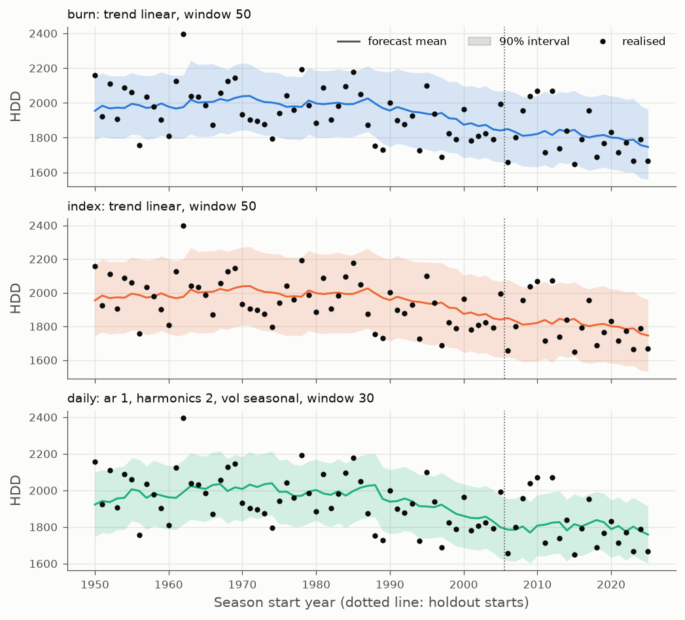

# Pricing a winter HDD option on Central England Temperature

An out-of-sample test of three ways to price a winter heating-degree-day (HDD) option from temperature history alone (burn analysis, a normal index model and a daily mean-reverting temperature model), walked forward over 76 winters of the Met Office Central England Temperature series.

## Results

<!-- results:start -->
*Generated by `scripts/reproduce.py` on 2026-10-30 00:56 UTC (commit `f1ad500+dirty`). Data: HadCET v2.1.1.0 + provisional (2026 onwards), file last date 2026-10-28, SHA-256 of the 1900-11-01 to 2026-03-31 slice `a2f252cb1ac8`. 24 variants tried; 56 development seasons (1950/51 to 2005/06), 20 holdout seasons (2006/07 to 2025/26). Seasons using provisional data: 2025/26.*

Base 18 °C, tick £20 per HDD, prices undiscounted. CRPS and bias in HDD; lower CRPS is better; Δ is the paired difference against the baseline (negative = better), ± one Newey-West standard error. MDE: the smallest bias a 5% test would detect with 80% power on that sample.

| Method | Dev CRPS | Dev Δ vs baseline | Holdout CRPS | Holdout Δ vs baseline | Holdout bias of E[H] | 90% cover dev / holdout | z-RMS dev | Holdout ATM call: mean error £ (MDE) | Mean ATM price £ |
|---|---|---|---|---|---|---|---|---|---|
| **baseline** (trend none, window 30) | 79.8 | - | 84.2 | - | -64.7 ± 27.6 | 82% / 80% | 1.06 | -464 ± 330 (924) | 1130 |
| **burn** (trend linear, window 50) | 77.1 | -2.7 ± 2.1 | 78.2 | -6.1 ± 8.9 | -2.4 ± 30.5 | 84% / 75% | 1.04 | +59 ± 356 (997) | 607 |
| **index** (trend linear, window 50) | 77.0 | -2.8 ± 2.1 | 78.4 | -5.8 ± 8.2 | -2.4 ± 30.5 | 91% / 90% | 0.98 | +93 ± 352 (988) | 573 |
| **daily** (ar 1, harmonics 2, vol seasonal, window 30) | 79.0 | -0.8 ± 3.7 | 80.0 | -4.3 ± 12.1 | +8.3 ± 34.0 | 77% / 80% | 1.31 | +368 ± 362 (1013) | 297 |

**Pre-registered predictions** (written 29 Oct 2026, before any real-data run; rules in `docs/decisions.md`):

|  | Prediction | Evidence | Verdict |
|---|---|---|---|
| P1 | Undetrended burn overestimates E[H] in recent decades. | holdout -64.7 HDD (SE 27.6, t -2.34, n 20); development seasons 1980-2005: -66.1 HDD (SE 25.1) | **supported** |
| P2 | The daily AR model's predictive sd of H is too small, so its 90% intervals under-cover. | development 90% coverage 77% of 56 (z -3.30); z-RMS 1.31 (SE 0.12); holdout 90% coverage 80% of 20 | **supported** |
| P3 | On the holdout, no pair of frozen methods differs significantly in squared ATM-call pricing error. | burn vs index: t +0.22; burn vs daily: t -0.43; index vs daily: t -0.50 | **supported** |

**Monte Carlo check:** base 18 °C (76 seasons): Bachelier-vs-MC z on the linear-index call mean -0.20, sd 0.97, max |z| 2.2; exact E[H] vs MC z sd 1.00, max |z| 2.6; truncation gap 0.00% of the ATM price (MC standard error 1.9%).

**Most extreme holdout seasons** (furthest from the 30-season reference mean):

| Season | Realised H | vs 30-season reference | ATM call payoff £ | baseline: mean / PIT / price £ | burn: mean / PIT / price £ | index: mean / PIT / price £ | daily: mean / PIT / price £ |
|---|---|---|---|---|---|---|---|
| 2006/07 | 1658 | -1.9 sd | 0 | 1918 / 0.00 / 1122 | 1849 / 0.06 / 551 | 1849 / 0.08 / 553 | 1786 / 0.11 / 99 |
| 2015/16 | 1648 | -1.7 sd | 0 | 1890 / 0.00 / 1177 | 1845 / 0.04 / 715 | 1845 / 0.07 / 677 | 1815 / 0.05 / 266 |
| 2011/12 | 1714 | -1.4 sd | 0 | 1913 / 0.07 / 1169 | 1838 / 0.14 / 539 | 1838 / 0.18 / 516 | 1813 / 0.17 / 183 |
| 2023/24 | 1666 | -1.4 sd | 0 | 1850 / 0.03 / 1093 | 1788 / 0.16 / 607 | 1788 / 0.18 / 564 | 1802 / 0.08 / 380 |
| 2012/13 | 2070 | +1.3 sd | 3659 | 1888 / 0.90 / 1161 | 1815 / 0.98 / 572 | 1815 / 0.97 / 528 | 1824 / 0.99 / 342 |

Share of each method's total squared ATM-call pricing error from the two most extreme holdout seasons: baseline 7%, burn 2%, index 2%, daily 0%.



Full tables, all variants, robustness checks and diagnostics: [`results/summary.md`](results/summary.md).
<!-- results:end -->

**What the first run shows** (30 October 2026; the block above is regenerated on every run, these notes are not):

- **Detrending matters most.** The undetrended baseline expected too many degree days on the holdout, as predicted (P1), and so overpriced calls and underpriced puts. Both methods with a linear trend were close to unbiased.
- **The most elaborate model was the worst calibrated.** The daily temperature model's mean forecasts were competitive, but its spread was too narrow (P2): its 90% intervals missed far more than 10% of development winters, and it priced the at-the-money call at about half what the burn and index methods did. Short-memory dynamics understate how much whole winters vary. Adding AR(3) lags removed the residual autocorrelation in the daily fit but made the season-level calibration worse.
- **Twenty winters cannot rank the rest.** The index model with a linear trend was the best calibrated. But on the holdout no frozen method beats the baseline's CRPS significantly, and no pair of methods differs significantly in at-the-money pricing accuracy (P3), as the power calculation predicted.
- **One planned robustness check tested nothing.** CET daily means almost never reach 15.5 °C between November and March, so the 15.5 °C index is the 18 °C index minus a constant and gives the same scores (D25).

## The problem and why it matters

Gas and power demand rise when winters are cold, so utilities, energy retailers and their insurers hedge with degree-day contracts that pay on accumulated cold. The index here is

$$H = \sum_{t=\text{1 Nov}}^{\text{31 Mar}} \max(18\,^\circ\mathrm{C} - T_t,\ 0),$$

the season's total heating degree days, where $T_t$ is the daily mean temperature.

Temperature is not a traded asset. Nobody can hold it, so no portfolio replicates an HDD option and there is no unique risk-neutral price: the market is incomplete. This project therefore prices with the **expected payoff under a model fitted to history**, which assumes a zero market price of weather risk, and shows a risk loading $E[\text{payoff}] + \alpha\,\mathrm{sd}[\text{payoff}]$ as a sensitivity. None of the prices here is an "arbitrage-free price". Pricing then becomes a forecasting problem: a good price needs a well-calibrated forecast of the whole distribution of $H$, and the test is how those forecasts held up on winters the models had not seen.

**The contract is hypothetical.** No exchange lists an option on CET, and CET is a regional composite rather than a single weather station, so a real hedger would face basis risk between this index and their own exposure.

| Term | Value |
|---|---|
| Index | Sum of max(18 °C − CET daily mean, 0), 1 Nov to 31 Mar (151 or 152 days) |
| Tick | £20 per HDD, paid at season end |
| Instruments | HDD swap; calls and puts at three strikes |
| Strikes | Mean − 1 sd, mean, mean + 1 sd of the previous 30 seasons' totals, the same for every method |
| Pricing date | 31 October, using only data up to that day |
| Prices | Undiscounted expected payoff; present values only in the forecast script |

## Data and licence

- **Source:** Met Office Hadley Centre daily Central England Temperature, [HadCET](https://www.metoffice.gov.uk/hadobs/hadcet/data/download.html), file `meantemp_daily_totals.txt`, version v2.1.1.0 plus provisional values from 2026.
- **Licence:** [Open Government Licence v3](http://www.nationalarchives.gov.uk/doc/open-government-licence/version/3/). Cite as the [CEDA catalogue record](https://catalogue.ceda.ac.uk/uuid/31819552d6764b58871507bc20f6b198/) asks: *Met Office (2026): Daily Mean, Minimum and Maximum Central England Temperature (HadCET) series v2.1.1.0.*
- **Download:** `scripts/download_data.py` fetches the file, never commits it, and records the download time and file hash. Each run records a SHA-256 of the exact slice used (1 Nov 1900 to 31 Mar 2026), which stays fixed as new days are appended.
- **Used:** daily means from 1 November 1900 (decision D7).

Known flaws, and how this project handles them:

- **A composite, not a station.** CET is built from several stations, with station and urban homogenisation adjustments, and represents a triangle between Lancashire, London and Bristol. Hence the basis-risk caveat above.
- **The construction changes in 1973.** Before 1973 the daily mean is anchored to Gordon Manley's monthly series; after it, the series is built from station observations with adjustments. This change falls inside the estimation windows; it is listed under limitations.
- **The early record is reconstructed.** Daily values before 1853 come from a different set of historical stations. Nothing before 1900 is used.
- **Recent values are provisional.** Values from January 2026 are provisional and may be revised. Only the last holdout winter (2025/26) touches them, and every run lists the affected seasons.
- **Today's data are not what was known then.** The series is revised as a whole, so a 1960 forecast here uses 1960-era data as homogenised today. No test can remove this; see limitations.

## Approach

Each method turns past data into a predictive distribution for $H$. A price is the expected payoff under that distribution.

**1. Burn analysis.** Take the totals of the last 30 or 50 seasons, optionally move each to this year's trend level with a straight-line fit ($H_j + \hat b\,(y - j)$), and treat them as equally likely outcomes. The price of a call is the average of $\max(H_j - K, 0)$. This is what practitioners do first, and the baseline here is its simplest form: 30 seasons, no detrending.

**2. Index modelling.** Fit a normal distribution to the same (detrended) totals and price in closed form. For $H \sim N(m, s^2)$ the call is the Bachelier formula

$$C = (m - K)\,\Phi(d) + s\,\varphi(d), \qquad d = \frac{m - K}{s}.$$

The predictive $s$ includes the uncertainty in the estimated mean or trend line, not just the scatter around it (D12).

**3. Daily model.** Model the temperature itself, then simulate the season:

$$T_t = s(t) + X_t, \qquad X_t = \sum_{i=1}^{p} \phi_i X_{t-i} + \sigma(t)\,\varepsilon_t,$$

where $s(t)$ is a linear trend plus 2 or 3 annual Fourier harmonics, and with $p = 1$ the anomaly $X_t$ is the daily discretisation of an Ornstein–Uhlenbeck process, $\phi = e^{-\kappa}$. Everything is fitted by least squares on the 30 or 50 years before the pricing date. The simulation starts from the last observed anomalies on 31 October and uses 10,000 paths. The code is in `src/hddlab/daily_model.py`.

**The cross-check (D14).** Because $X$ is a linear Gaussian process, the linear index $L = \sum (18 - T_t)$ is exactly Gaussian, and its mean and variance follow from propagating the state's mean and covariance through the season. A call on $L$ therefore has an exact Bachelier price, and $E[H]$ is exact as a sum of per-day Gaussian expectations. The Monte Carlo must match both within its standard error, season by season. $H$ itself is not exactly Gaussian, because $H = L + \sum \max(T_t - 18, 0) \ge L$; the size of that gap is reported rather than hidden. On CET it is negligible, because no daily mean since 1900 has reached 18 °C between November and March.

**Variants.** 24 in total: burn and index each with trend {none, linear} × window {30, 50}; the daily model with AR order {1, 3} × harmonics {2, 3} × volatility {constant, seasonal} × window {30, 50} (D13, D23). Every variant is reported.

## Evaluation and error analysis

- **Walk-forward:** season $y$ is priced using only data up to 31 October of year $y$. A test scrambles every value after the cutoff and checks that no forecast changes.
- **Split:** development seasons 1950/51 to 2005/06 (56); holdout 2006/07 to 2025/26 (20).
- **Selection, fixed in advance (D15):** in each family, the variant with the lowest development CRPS at 18 °C is frozen and written to `results/frozen.json` before any holdout season is forecast. The holdout evaluates only those three variants and the baseline. Every holdout evaluation is logged in `results/holdout_runs.log`.
- **Metrics:** CRPS of $H$ (a proper score for the whole distribution; lower is better) as paired differences against the baseline; bias and RMSE of $E[H]$; coverage of 50/80/90% intervals; PIT histograms; the RMS of standardised errors (about 1 if the spread is right). Standard errors are Newey-West with 3 lags, because a missed trend produces runs of same-signed errors.
- **Pricing error:** mean of (realised payoff − price) in pounds, with its standard error, the number of seasons and the **minimum detectable effect** (the smallest bias a 5% test would find with 80% power). For an at-the-money call, the payoff's sd is about 1.46 times its price, so 20 seasons can only detect a bias of roughly 90% of the price. That is why the headline is the distributional metrics (D17).
- **Pre-registered predictions (D16)**, written before any real-data run, with decision rules that the code applies:
  - P1: undetrended burn overestimates $E[H]$ in recent decades;
  - P2: the daily model's intervals are too narrow, because short-memory models understate year-to-year variability ([Caballero, Jewson and Brix, 2002](https://doi.org/10.3354/cr021127));
  - P3: on 20 holdout seasons, no pair of methods differs significantly in at-the-money pricing accuracy.
- **Robustness:** estimation window and trend form (in the variant grid); the best variant in each half of the development period; risk loading; base temperature 15.5 °C, which turned out to be uninformative on CET (D25).
- **Error analysis:** the most extreme holdout winters, what each method expected and how much of each method's squared pricing error they account for (in the results block and `results/summary.md`).
- **Benchmarks:** the naive burn baseline, and the exact closed forms for the Monte Carlo.

This is a pricing study, not a trading strategy, so there are no transaction costs, turnover, Sharpe ratios or equity curves to report.

| Figure | What it shows |
|---|---|
| `results/figures/walkforward_intervals.png` | Each frozen method's forecast mean and 90% interval against the realised index, 1950–2025 |
| `results/figures/coverage.png` | Empirical against nominal interval coverage, development and holdout |
| `results/figures/pit_development.png` | PIT histograms; flat means calibrated |
| `results/figures/closed_form_check.png` | Monte Carlo minus exact results, in standard errors |
| `results/figures/seasonal_index.png` | The realised index by season, with the split marked |

## How to reproduce

Requires Python 3.12 or newer (tested on 3.13). From the repository root:

```bash
python3 -m venv .venv
source .venv/bin/activate
pip install -r requirements.txt            # pinned versions, installs this package too
python scripts/download_data.py            # one text file (~2 MB) from the Met Office
pytest -q                                  # 65 tests, about 10 s
python scripts/reproduce.py                # about 1 minute; rewrites results/ and the Results block above
python scripts/mutation_check.py           # optional, about 2 minutes: 14 injected bugs, each must fail the tests
```

If the download fails (for example a certificate error), open the data URL in a browser, save the page as a `.txt` file and run `python scripts/download_data.py --file /path/to/file.txt`.

`python scripts/reproduce.py --synthetic` runs the whole pipeline on synthetic data into `results-synthetic/` without touching this README; it is a smoke test, not a result.

The pre-registered forecast for December 2026 to March 2027 (D19):

```bash
python scripts/forecast.py make --season-start 2026-12-01 --season-end 2027-03-31   # commit the output before 1 Dec 2026
python scripts/forecast.py score forecasts/2026-27_1201-0331.json                   # after March 2027 data are published
```

## Project structure

```
configs/default.toml          every contract, data and model parameter
scripts/download_data.py      download HadCET and record provenance
scripts/reproduce.py          the whole study; writes results/ and the README results block
scripts/forecast.py           pre-registered forecast of a future season, and its scoring
scripts/mutation_check.py     injects known bugs and checks the tests catch them
src/hddlab/
  data.py                     parse and validate the Met Office file; slice hash
  seasons.py                  season calendars, HDD, leap-day adjustment
  seasonal_methods.py         burn analysis, index model, reference strikes
  daily_model.py              seasonal mean + AR model, simulation, exact Gaussian moments
  distributions.py            forecast distributions, Bachelier prices, CRPS
  walkforward.py              walk-forward harness (the only code that sees temperatures)
  evaluate.py                 scores, selection rule, pre-registered verdicts
  metrics.py                  Newey-West SEs, coverage, minimum detectable effect
  diagnostics.py              warm-day counts, residual checks
  pipeline.py, report.py, figures.py   orchestration and output
  synthetic.py                CET-like synthetic data for tests and the smoke run
tests/                        65 tests: hand-computed HDD, leap seasons, closed forms vs integration,
                              simulator vs analytic OU moments, Monte Carlo vs exact, no look-ahead
results/                      generated: summary.md, metrics.json, per-season CSVs, figures, frozen.json
forecasts/                    pre-registered forecasts (committed before each season starts)
docs/decisions.md             every modelling decision, its alternatives and the reason
docs/defence.md               interview defence sheet
```

## Limitations and what would break this

- **Short memory.** AR models forget within days, so the daily model may understate how much whole winters vary (P2 tests this). A long-memory (ARFIMA) anomaly model is the known fix and the obvious next step.
- **Trend extrapolation.** Warming has not been linear since 1900. A straight line fitted over 30 or 50 years and extended one year ahead can lag a recent acceleration or overshoot a pause. Burn without detrending ignores warming altogether.
- **Small samples.** 20 holdout winters cannot separate methods whose prices differ by less than most of an option's value (see the minimum detectable effects). One or two extreme winters can dominate the holdout.
- **Look-ahead that tests cannot catch.** The data are today's homogenised version, not what was available at each pricing date, and anyone who follows the weather knows recent winters were mild. The defences are the pre-registered rules, the frozen split and the forecast committed before its season.
- **The 1973 construction change** inside the estimation windows.
- **Pre-registration evidence.** The design and predictions were committed locally before the first real-data run but pushed to GitHub afterwards, so their timing rests on local git timestamps (D24). The forecast for December 2026 to March 2027 is the publicly timestamped test.
- **Zero market price of risk.** Real weather prices include a risk premium, and real contracts usually cap payouts; neither is modelled. The risk loading is only a sensitivity.
- **No weather forecasts.** Close to and during a season, desks use meteorological forecasts; this study prices from climatology alone.
- **What would break this:** a sudden climate regime change, which breaks both burn and trend extrapolation; a revision of the HadCET series; hedging a specific station or city, where CET's basis risk dominates; or reading these expected payoffs as tradable prices.

Next steps: an ARFIMA or two-timescale anomaly model; monthly sub-indices to get more independent outcomes; station-level data to measure basis risk; scoring the pre-registered forecast in April 2027.
